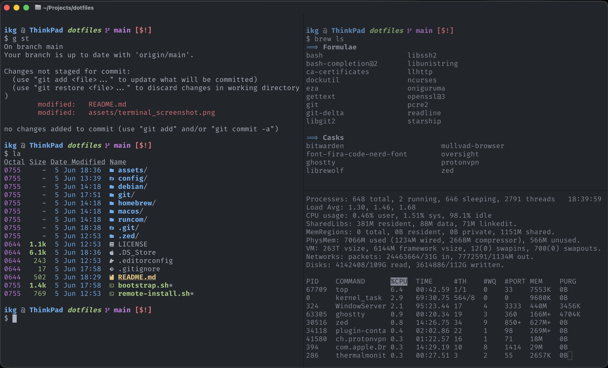

# Dotfiles

My configuration for macOS and Linux.

## Install

Download with:

```bash
curl -L https://codeberg.org/parser/dotfiles/raw/branch/main/scripts/remote-install.sh | bash
cd dotfiles/
```

### macOS

```bash
bash macos/install.sh  # Installs Homebrew, installs packages
bash scripts/bootstrap.sh # Symlinks configs, prompts for Git config setup, install VSCodium extensions
bash scripts/mac-bootstrap.sh # Symlinks VSCodium settings, runs defaults.sh, switches to modern bash
```

### Linux

```bash
bash linux/arch/install.sh # Installs apps
bash scripts/bootstrap.sh  # Symlinks configs, prompts for Git config setup, install VSCodium extensions
bash scripts/linux-bootstrap.sh # Symlinks VSCodium settings, symlinks Linux specific configs and system settings
```

## What gets linked

| Source                 | Destination                   |
| ---------------------- | ----------------------------- |
| `config/<dir>/<file>`  | `~/.config/<dir>/<file>`      |
| `home/.<file>`         | `~/.<file>`                   |
| `vscode/settings.json` | VSCodium `User/settings.json` |

Configs: Fastfetch, Ghostty, Git, Starship, Zed

Shell dotfiles: `.aliases`, `.bash_profile`, `.bashrc`, `.exports`, `.inputrc`

Vim: `.vimrc` + `.vim/`

## Uninstall

```bash
bash scripts/uninstall.sh  # only removes symlinks bootstrap.sh created
```


